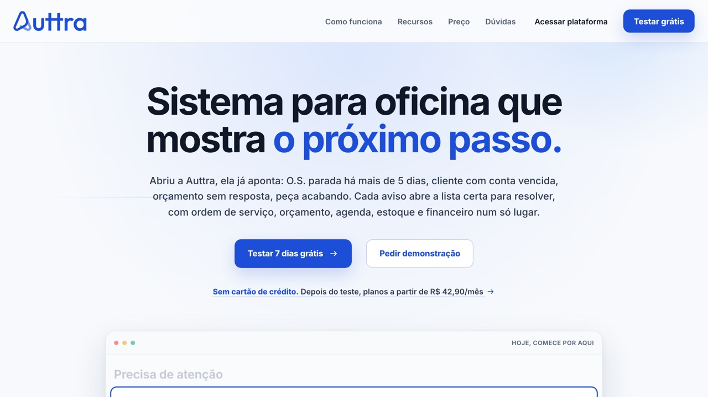
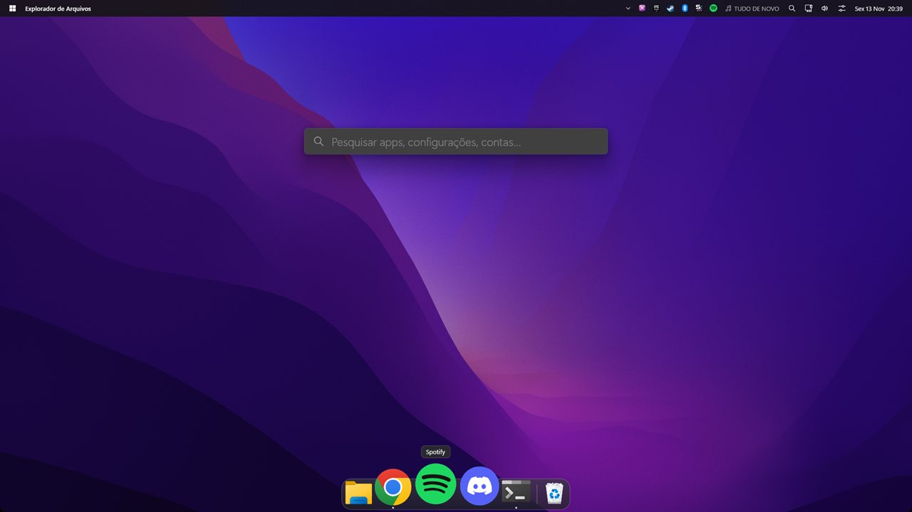

## Lucas Oliverio

Desenvolvedor fullstack na Next Fit e estudante de Engenharia de Software na SATC, em Criciúma/SC.

📫 olucasoliverio@gmail.com

### Projetos

<table>
<tr>
<td width="50%" valign="top">

**[Auttra](https://auttra.com.br)** · Sistema para Gestão de Oficinas Mecânicas

Estou construindo com o [Lucas Gaspar](https://github.com/LucasGasparA). Junta ordem de serviço, orçamento, agenda, estoque e financeiro, e a tela inicial já aponta o que precisa de atenção: O.S. parada, conta vencida, orçamento sem resposta, peça acabando.

</td>
<td width="50%" valign="top">

**[Doca](https://github.com/olucasoliverio/Doca)** · Dock e Barra de menu do macOS no Windows 11

Substitui a barra de tarefas por uma Dock com ampliação, barra de menu no topo, Spotlight no Alt+Espaço, Central de Controle com Wi-Fi, Bluetooth e som, e controle de música.

</td>
</tr>
</table>

### Na Next Fit

Ferramentas internas que fiz para o time de atendimento. O código é fechado.

<table>
<tr>
<td width="50%" valign="top">

**🔀 Roteia**

Distribui as conversas do Freshchat entre os agentes do suporte, respeitando horário, pausas e carga de cada um.

O que ele faz

- **Distribuição**: recebe cada conversa nova por webhook, coloca numa fila e atribui por rodízio, uma de cada vez, para duas conversas que chegam juntas não caírem no mesmo agente.
- **Regras por agente**: limite diário, indisponibilidade no dia ou permanente, e carga reduzida, em que o agente pula algumas vezes depois de receber.
- **Turnos**: conversas que chegam fora do horário ficam pendentes e são distribuídas quando o turno começa. Tem grupos de pausa e sincronização diária dos agentes.
- **Painéis**: dashboard em tempo real com atribuições, resoluções, falhas e gráfico de distribuição, calendário de horários e histórico de alterações. Os agentes têm um painel próprio para cadastrar as ausências.

Node.js · BullMQ · Postgres · Redis · React

</td>
<td width="50%" valign="top">

**📚 Central de Ajuda com IA**

Escreve e mantém os artigos da central de ajuda a partir de uma base vetorial sincronizada com o Freshdesk.

O que ela faz

- **Gerador**: transforma documentos do produto em artigo, passando por plano, ajuste e texto final no padrão de escrita da empresa.
- **Análise de impacto**: recebe o comunicado de uma mudança no produto e aponta quais artigos precisam ser atualizados, com uma segunda etapa que confere cada um.
- **Revisão**: dá nota de qualidade e reescreve artigos existentes.
- **Busca**: combina semântica, palavra-chave, data de atualização e artigos de referência.

NestJS · BullMQ · Prisma · pgvector · React · Gemini

</td>
</tr>
<tr>
<td width="50%" valign="top">

**📊 Análise de Atendimentos**

Lê as conversas de um cliente no Freshchat e gera um relatório do atendimento com Gemini.

O que ela faz

- **Entrada**: busca as conversas pelo e-mail do cliente e analisa uma conversa só ou várias juntas, em lote e em segundo plano.
- **Leitura completa**: além do texto, o modelo vê as imagens, áudios e vídeos enviados. Conversas longas são compactadas antes.
- **Relatório**: resumo executivo, problema principal, linha do tempo, passagens entre agentes, como o atendimento foi conduzido, evidências e ações recomendadas.
- **Risco**: classifica a chance de o cliente voltar a chamar, ficar insatisfeito ou cancelar.

Express · Prisma · React · Gemini

</td>
<td width="50%" valign="top">

**📸 NextPrint**

Fork do Flameshot que envia as capturas de tela direto para o Google Drive de quem está logado, sem servidor próprio.

O que ele faz

- **Login**: OAuth do Google com PKCE, restrito às contas da empresa. Só o refresh token fica guardado, no Keychain do macOS ou no Gerenciador de Credenciais do Windows.
- **Envio**: a captura vai para uma pasta própria no Drive, com um escopo que só enxerga os arquivos criados pelo app. O link é copiado na hora.
- **Compartilhamento**: tenta "qualquer pessoa com o link" e, se a política da empresa bloquear, cai para "qualquer pessoa da empresa".
- **Distribuição**: o instalador do Windows (.msi) é gerado pelo GitHub Actions, e o do macOS sai assinado em .dmg.

C++ · Qt 6 · OAuth · GitHub Actions

</td>
</tr>
</table>

### Faculdade

**[Pipeline de Engenharia de Dados](https://github.com/olucasoliverio/Engenharia_Dados_Final)**: pipeline de um e-commerce em arquitetura medalhão, do MongoDB até um dashboard no Looker Studio.

Airflow · Spark · Delta Lake · MinIO

### Tecnologias

